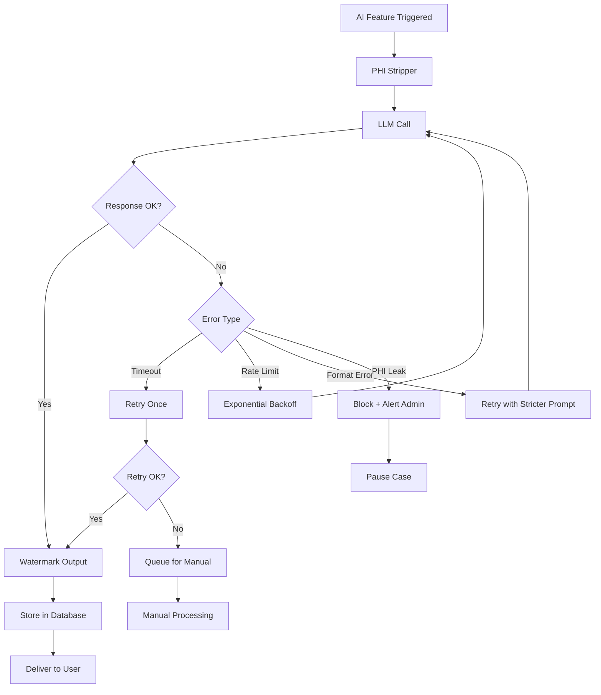
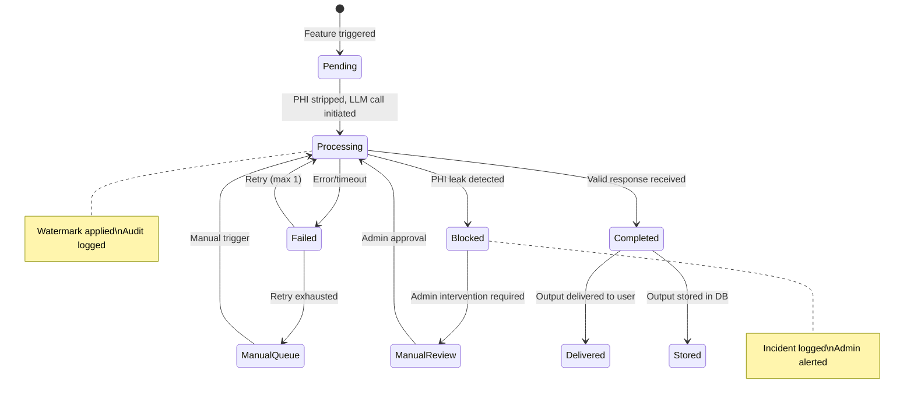

# AI Feature Layer

Overview of the 6 AI features, safety mechanisms, and integration points.

## Feature Overview

| # | Feature | Trigger | Input | Output | Model |
|---|---------|---------|-------|--------|-------|
| 1 | **Intelligent Case Routing** | Case created + payment confirmed | Case metadata (serviceType, description, urgency) | Specialist assignment | GPT-4o |
| 2 | **AI Pre-screening** | Case routed to specialist | Clinical records (PHI-stripped) | Structured pre-screen report | GPT-4o |
| 3 | **Plain-language Summary** | Opinion signed | Specialist opinion (PHI-stripped) | Patient-friendly summary | GPT-4o |
| 4 | **Multi-opinion Synthesis** | 2-4 opinions received | Multiple opinions (PHI-stripped) | Consensus summary with agreements/disagreements | GPT-4o |
| 5 | **Follow-up Q&A** | Patient asks question | Question + opinion scope | Answer within documented scope | GPT-4o-mini |
| 6 | **Result Trend Analysis** | New lab result uploaded | Historical lab data (PHI-stripped) | Trend analysis + significant changes flagged | GPT-4o |

## Feature Descriptions

### 1. Intelligent Case Routing

Analyzes case metadata and matches to the most appropriate specialist by subspecialty and current availability. Eliminates manual triage.

**Inputs:** Service type, clinical description, urgency flags, required subspecialty
**Outputs:** Specialist assignment, confidence score, routing rationale
**Timeout:** 4 hours — if no match, admin alerted

### 2. AI Pre-screening

Before a specialist opens a case, reads clinical notes and prior reports. Produces a structured pre-screen: key findings, differentials to consider, urgent flags. Specialist reviews the human record; AI surfaces what matters first.

**Inputs:** Case records (slides metadata, DICOM headers, lab values — all PHI-stripped)
**Outputs:** Key findings, differential diagnoses to consider, urgent flags, relevant history
**Watermark:** "AI-Generated Pre-screen — For Specialist Review Only"

### 3. Plain-language Summary

Translates the specialist's written opinion into patient-friendly language. No medical jargon. Written as if by a trusted GP.

**Inputs:** Specialist opinion content (PHI-stripped)
**Outputs:** Plain-language summary (200-500 words)
**Watermark:** "AI-Generated Summary — Based on Specialist Opinion"

### 4. Multi-opinion Synthesis

When a case receives opinions from 2-4 specialists, synthesizes areas of agreement and disagreement into a consensus summary. Saves the patient from manually reconciling conflicting reports.

**Inputs:** 2-4 specialist opinions (PHI-stripped)
**Outputs:** Consensus text, agreements list, disagreements list
**Trigger:** Automatic when 2+ opinions are SIGNED for the same case

### 5. Follow-up Q&A

After report delivery, the patient asks questions. AI answers within the documented scope of the written opinion. Reduces support load, gives patients clarity faster.

**Inputs:** Patient question, original specialist opinion content
**Outputs:** Answer + scope note (confirming answer is within opinion scope)
**Guardrails:** Refuses questions outside opinion scope, suggests booking a consultation

### 6. Result Trend Analysis

For patients with repeat lab tests, tracks longitudinal trends and flags statistically significant changes. Early-warning signal for coordinators and physicians.

**Inputs:** Historical lab metrics (name, value, date, reference range)
**Outputs:** Trend direction, statistical significance flag, summary
**Threshold:** Flags changes exceeding 2 standard deviations from patient baseline

## PHI Stripping Table

Before any LLM call, the AI orchestrator strips identifiable data:

| Field Category | Example Values | Stripping Action | Replacement |
|---------------|----------------|-----------------|-------------|
| Patient name | "John Smith" | Remove | Omitted from prompt |
| Date of birth | "1985-03-15" | Generalize | "Adult patient" |
| MRN | "MRN-123456" | Remove | Omitted |
| Insurance ID | "INS-789012" | Remove | Omitted |
| Phone number | "+1-555-0123" | Remove | Omitted |
| Email | "john@example.com" | Remove | Omitted |
| Address | "123 Main St" | Remove | Omitted |
| Hospital name | "City General" | Generalize | "Referring facility" |
| Doctor name | "Dr. Jones" | Generalize | "Referring physician" |
| Admission date | "2024-01-10" | Relative time | "3 days prior" |
| Procedure date | "2024-01-12" | Relative time | "1 day prior" |

### Stripping Implementation

```typescript
// PHI Stripping Pipeline
function stripPHI(clinicalData: ClinicalData): StrippedClinicalData {
  return {
    // Remove identity fields
    name: undefined,
    dateOfBirth: undefined,
    mrn: undefined,
    
    // Generalize temporal fields
    temporalContext: computeRelativeTime(clinicalData.dates),
    
    // Generalize location
    facility: "Referring facility",
    
    // Preserve clinical content
    chiefComplaint: clinicalData.chiefComplaint,
    history: clinicalData.history,
    findings: clinicalData.findings,
    labValues: clinicalData.labValues,  // Values without patient identifiers
    imagingMetadata: clinicalData.imagingMetadata,  // DICOM headers without patient info
  };
}
```

## Watermarking Mechanism

Every AI output is watermarked to prevent misattribution:

| Output Type | Watermark Text | Placement |
|------------|---------------|-----------|
| Pre-screening | "AI-Generated Pre-screen — For Specialist Review Only" | Header + footer |
| Plain-language summary | "AI-Generated Summary — Based on Specialist Opinion [ID]" | Header + footer |
| Synthesis | "AI-Generated Synthesis — Based on Multiple Specialist Opinions" | Header + footer |
| Follow-up answer | "AI-Generated Response — Within scope of Opinion [ID]" | Footer |
| Trend analysis | "AI-Generated Analysis — For Clinical Review" | Header + footer |

### Watermark Implementation

```typescript
function watermarkOutput(content: string, type: AIOutputType, opinionId?: string): string {
  const watermarks = {
    PRE_SCREEN: "AI-Generated Pre-screen — For Specialist Review Only",
    PLAIN_SUMMARY: `AI-Generated Summary — Based on Specialist Opinion ${opinionId}`,
    SYNTHESIS: "AI-Generated Synthesis — Based on Multiple Specialist Opinions",
    FOLLOW_UP: `AI-Generated Response — Within scope of Opinion ${opinionId}`,
    TREND: "AI-Generated Analysis — For Clinical Review",
  };
  
  return `\n---\n${watermarks[type]}\n---\n${content}\n---\n`;
}
```

## Error Handling Scenarios

| Scenario | Detection | Response | User Impact |
|----------|-----------|----------|-------------|
| **LLM timeout** | 30-second timeout | Retry once, then queue for manual processing | 1-2 minute delay |
| **LLM rate limit** | 429 response | Exponential backoff, queue subsequent requests | 5-10 minute delay |
| **PHI leak detected** | Output scan finds identifiers | Block output, log incident, alert admin | Case paused, manual review |
| **Invalid response format** | Schema validation failure | Retry with stricter prompt, fallback to manual | 1-2 minute delay |
| **Model error/hallucination** | Output contradicts clinical data | Flag for specialist review, do not deliver | Specialist notified |
| **Scope violation (Q&A)** | Answer exceeds opinion scope | Refuse with explanation, suggest consultation | Patient redirected |
| **No specialist match** | Routing timeout (4 hours) | Alert admin, notify patient with revised ETA | Case delayed |
| **Corrupt clinical data** | Parsing failure | Flag case, notify patient to re-upload | Patient re-uploads |

### Error Response Flow



## Integration Points

### AI Orchestrator

The AI orchestrator is the central coordination point for all AI features:

```typescript
interface AIOrchestrator {
  // Core pipeline
  stripPHI(data: ClinicalData): StrippedData;
  buildPrompt(feature: AIFeature, data: StrippedData): Prompt;
  callLLM(prompt: Prompt): LLMResponse;
  validateOutput(response: LLMResponse): ValidatedOutput;
  watermark(content: string, type: AIOutputType): string;
  logAudit(feature: AIFeature, input: StrippedData, output: ValidatedOutput): void;
  
  // Feature-specific
  routeCase(caseData: CaseMetadata): RoutingResult;
  preScreen(records: CaseRecord[]): PreScreenResult;
  generateSummary(opinion: SpecialistOpinion): PlainSummary;
  synthesizeOpinions(opinions: SpecialistOpinion[]): SynthesisResult;
  answerFollowUp(question: string, opinion: SpecialistOpinion): FollowUpAnswer;
  analyzeTrends(metrics: LabMetric[]): TrendResult;
}
```

### External API Integration

| Service | Purpose | Call Frequency | Rate Limit |
|---------|---------|---------------|------------|
| **OpenAI** | All 6 AI features | ~10-50 calls/day per active case | 10K RPM |
| **Stripe** | Payment processing | Per case payment | Standard Stripe limits |
| **Email** | Notifications | Per case event | Provider dependent |
| **WhatsApp** | Urgent alerts only | <5/day (critical findings) | WhatsApp Business limits |

### Database Integration

AI features interact with these models:

| Model | Read By | Written By |
|-------|---------|-----------|
| `Case` | All AI features (context) | Routing, status updates |
| `CaseRecord` | Pre-screening (clinical data) | File upload service |
| `SpecialistOpinion` | Summary, synthesis, Q&A | Specialist portal |
| `AIPrescreen` | Specialist portal (display) | Pre-screening feature |
| `PlainLanguageSummary` | Patient portal (display) | Summary feature |
| `OpinionSynthesis` | Patient portal (display) | Synthesis feature |
| `FollowUpQuestion` | Patient portal (display) | Q&A feature |
| `TrendAnalysis` | Patient portal (display) | Trend feature |
| `AuditLog` | Admin portal (compliance) | All AI features (logging) |

## State Transitions for AI Features


