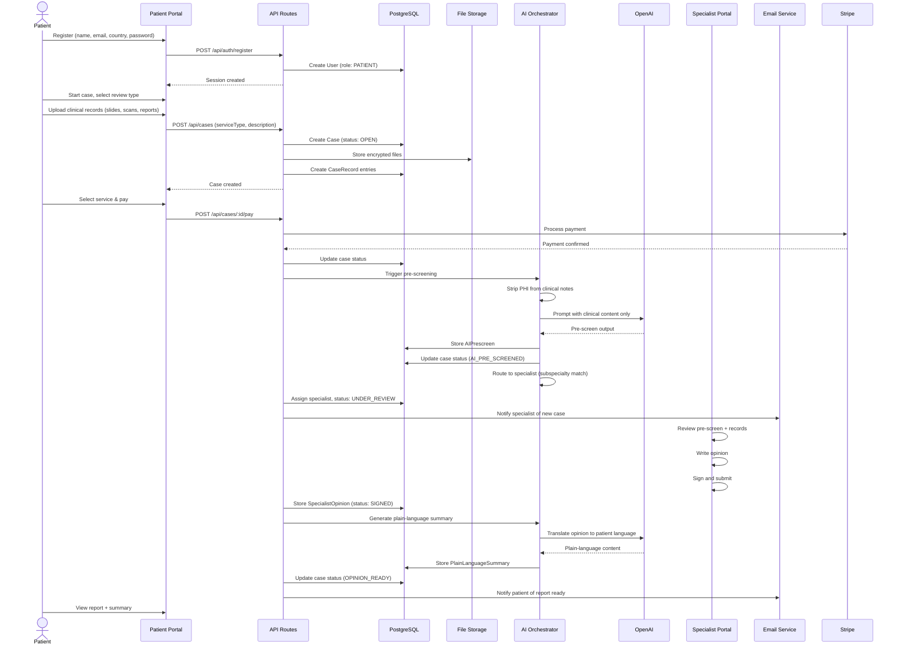
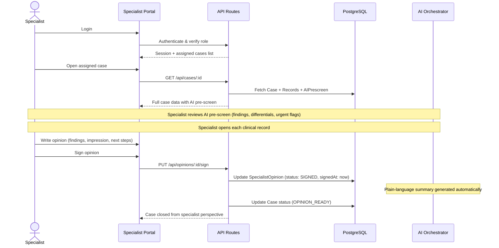
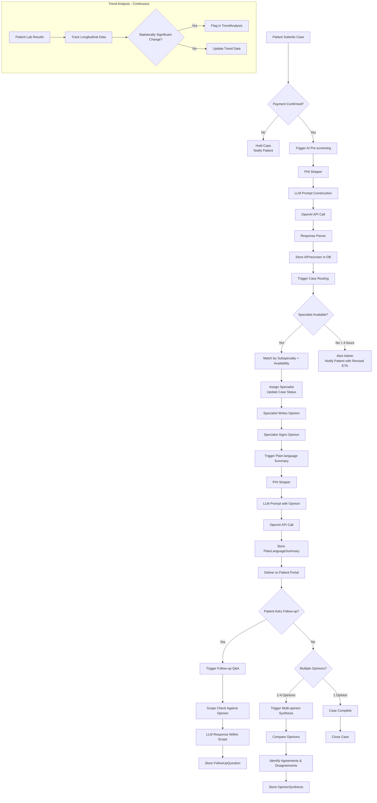
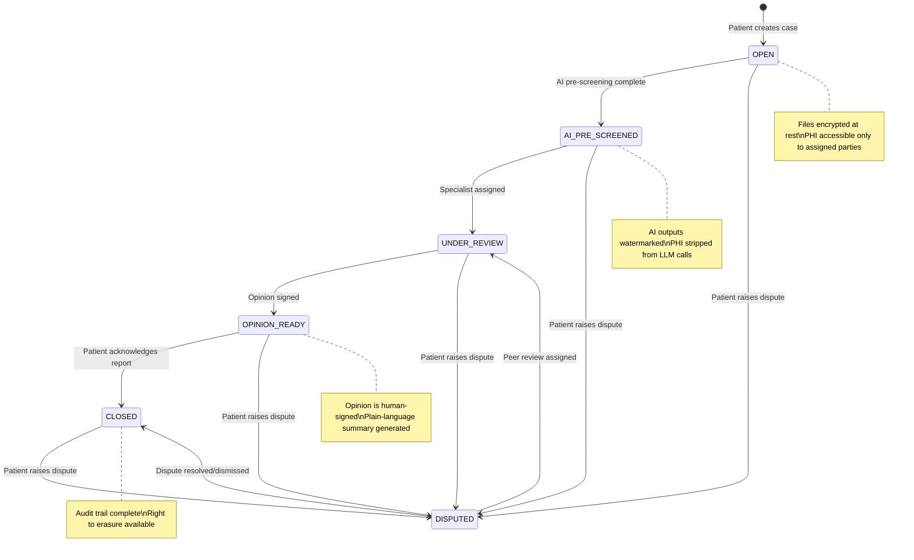
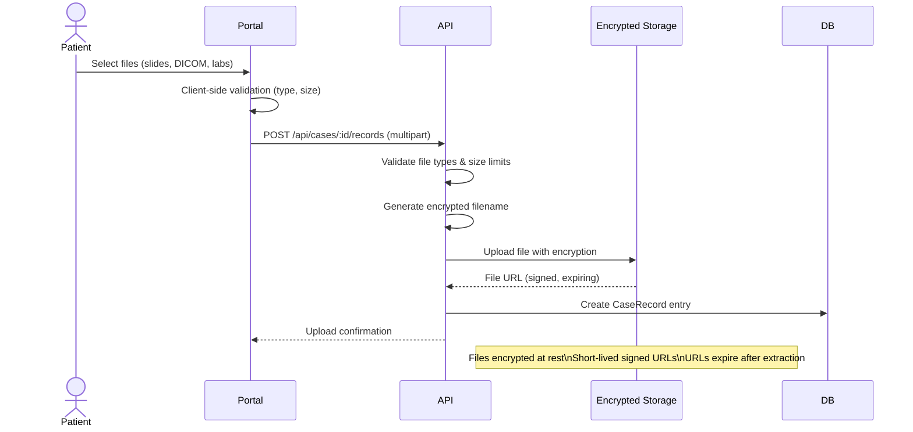

# Data Flow

How data moves through the Dr. Bubal Care platform across key workflows.

## Patient Case Workflow Sequence

## Specialist Review Flow

## AI Feature Triggers

## Data Lifecycle

## File Upload Flow

## State Transitions Reference

| Entity | State | Trigger | Next State(s) |
|--------|-------|---------|---------------|
| **Case** | `OPEN` | Payment confirmed | `AI_PRE_SCREENED`, `DISPUTED` |
| **Case** | `AI_PRE_SCREENED` | Specialist assigned | `UNDER_REVIEW`, `DISPUTED` |
| **Case** | `UNDER_REVIEW` | Opinion signed | `OPINION_READY`, `DISPUTED` |
| **Case** | `OPINION_READY` | Patient acknowledges | `CLOSED`, `DISPUTED` |
| **Case** | `DISPUTED` | Admin resolves | `UNDER_REVIEW` (peer review), `CLOSED` |
| **SpecialistOpinion** | `DRAFT` | Specialist saves | `SIGNED` |
| **SpecialistOpinion** | `SIGNED` | Specialist submits | `DELIVERED` |
| **SpecialistOpinion** | `DELIVERED` | Patient disputes | `DISPUTED` |
| **OpinionSynthesis** | `PENDING` | 2+ opinions received | `GENERATED` |
| **OpinionSynthesis** | `GENERATED` | Delivered to patient | `DELIVERED` |
