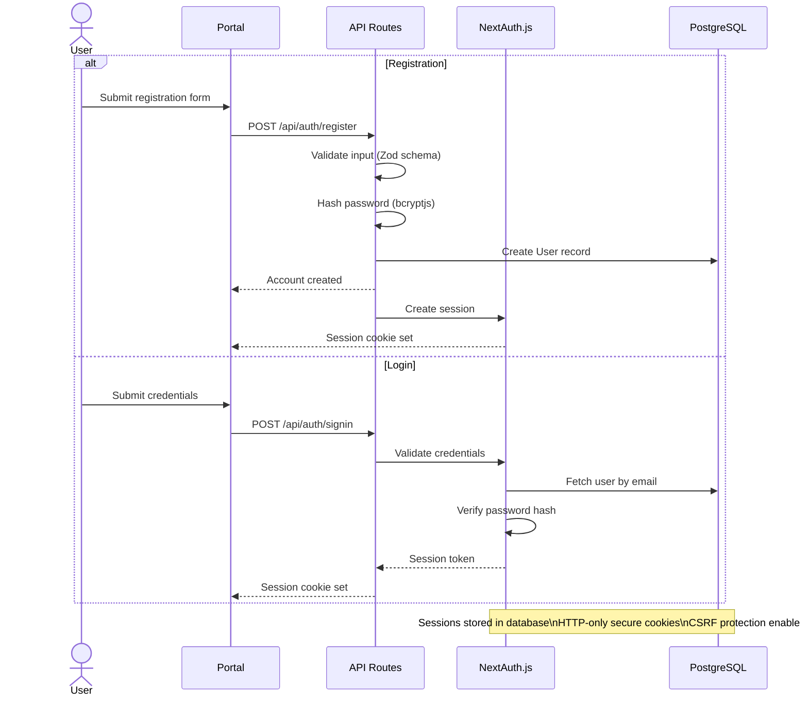
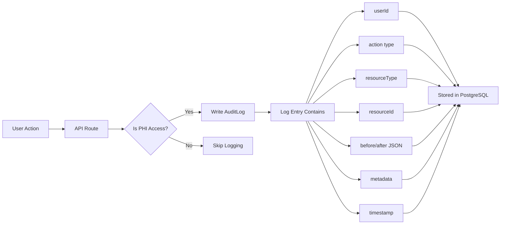

# Security Model

Security architecture, access controls, and compliance controls for Dr. Bubal Care.

## Authentication Flow



## Role-Based Access Control

### Patient

| Resource | Read | Write | Conditions |
|----------|------|-------|------------|
| Own profile | Yes | Yes | Own user ID |
| Own cases | Yes | Create new | Own patientId |
| Own case records | Yes | Upload | Own case's records |
| Own specialist opinions | Yes | No | Assigned to own cases |
| Own plain-language summaries | Yes | No | For own opinions |
| Own follow-up questions | Yes | Create new | For own opinions |
| Own lab results | Yes | No | Own patientId |
| Other patients' data | No | No | — |
| Audit logs | No | No | — |
| Admin functions | No | No | — |

### Specialist (Doctor)

| Resource | Read | Write | Conditions |
|----------|------|-------|------------|
| Assigned cases | Yes | Status updates | specialistId matches |
| Case records (assigned) | Yes | No | Must be assigned to case |
| AI pre-screens (assigned) | Yes | No | Must be assigned to case |
| Specialist opinions | Create | Draft → Sign | Must be assigned to case |
| Plain-language summaries | No | No | Generated by AI only |
| Other specialists' opinions | No | No | — |
| Patient profiles | Limited | No | Name only, no PHI |
| Platform analytics | No | No | — |

### Admin

| Resource | Read | Write | Conditions |
|----------|------|-------|------------|
| All cases | Yes | Status overrides | Admin role verified |
| All users | Yes | Verification status | Admin role verified |
| Audit logs | Yes | No | Full read access |
| Disputes | Yes | Resolution | Admin role verified |
| Platform metrics | Yes | No | Dashboard access |
| Specialist verification | Yes | Approve/reject | Admin role verified |
| Data deletion requests | Yes | Execute | GDPR compliance |

### Row-Level Security (Supabase)

```sql
-- Patient can only read own cases
CREATE POLICY "patient_own_cases" ON cases
  FOR SELECT USING (patient_id = auth.uid());

-- Specialist can only read assigned cases
CREATE POLICY "specialist_assigned_cases" ON cases
  FOR SELECT USING (specialist_id = auth.uid());

-- Admin can read all cases
CREATE POLICY "admin_all_cases" ON cases
  FOR SELECT USING (
    EXISTS (SELECT 1 FROM users WHERE id = auth.uid() AND role = 'ADMIN')
  );
```

## PHI Protection Methods

| Method | Implementation | Scope |
|--------|---------------|-------|
| **PHI Stripping** | Remove names, DOB, MRN before any LLM call | All AI features |
| **Data Minimization** | AI processes only clinical data needed for specific task | AI orchestrator |
| **Tokenization** | Replace identifiers with opaque tokens in prompts | AI prompt construction |
| **Output Filtering** | Scan AI outputs for leaked PHI before delivery | AI response handler |
| **Access Logging** | Log every PHI access in AuditLog | All data access |

### PHI Fields Protected

| Field Category | Examples | Stripping Method |
|---------------|----------|-----------------|
| **Identity** | Full name, nickname | Remove entirely |
| **Demographics** | Date of birth, age | Remove or generalize (e.g., "adult") |
| **Medical IDs** | MRN, insurance ID | Replace with opaque token |
| **Contact** | Phone, email, address | Remove entirely |
| **Location** | Hospital name, ward | Generalize (e.g., "referring facility") |
| **Dates** | Admission date, procedure date | Relative time only (e.g., "3 days ago") |

## Encryption Layers

| Layer | Method | Details |
|-------|--------|---------|
| **In Transit** | TLS 1.3 | All HTTP communication encrypted |
| **At Rest (Database)** | PostgreSQL TDE | Transparent Data Encryption via Supabase |
| **At Rest (Files)** | AES-256 | Supabase Storage server-side encryption |
| **Passwords** | bcryptjs | Cost factor 12, salted hashing |
| **Session Tokens** | HTTP-only cookies | Secure, SameSite=Strict |
| **File URLs** | Signed URLs | Short-lived (15 min), expire after use |
| **API Keys** | Environment variables | Never committed to repository |
| **AI Prompts** | PHI stripped | No identifiable data reaches LLM |

## Audit Logging Overview



### Audit Log Schema

```prisma
model AuditLog {
  id           String   @id @default(cuid())
  userId       String   // Who performed the action
  action       String   // CREATE, READ, UPDATE, DELETE, SIGN, ROUTE
  resourceType String   // Case, SpecialistOpinion, CaseRecord, etc.
  resourceId   String   // ID of the affected resource
  before       Json?    // State before change (for updates)
  after        Json?    // State after change
  metadata     Json?    // Additional context (IP, user agent, etc.)
  timestamp    DateTime @default(now())
}
```

### Logged Events

| Event Type | When Logged | Data Captured |
|-----------|-------------|---------------|
| **Case Created** | Patient creates case | patientId, serviceType, initial status |
| **Case Routed** | System assigns specialist | specialistId, routing algorithm used |
| **Opinion Signed** | Specialist signs opinion | specialistId, caseId, signedAt |
| **Opinion Delivered** | Patient receives report | deliveredAt, patient viewed |
| **File Accessed** | Any file download/view | userId, fileId, accessTime, IP |
| **PHI Stripped** | AI prompt construction | fields removed, prompt hash |
| **AI Output Generated** | AI feature completes | feature type, model used, output hash |
| **Dispute Filed** | Patient raises dispute | caseId, reason, opinionId |
| **Data Deletion** | GDPR erasure request | patientId, requestDate, completedDate |
| **Admin Override** | Admin changes case status | previousStatus, newStatus, reason |

## AI Safety Principles

| Principle | Implementation | Verification |
|-----------|---------------|-------------|
| **PHI-safe Prompting** | Identifiable data stripped before LLM call | PHI stripper validates before every prompt |
| **Documented Reasoning** | All AI outputs logged with version and hash | AuditLog entries for every AI call |
| **Human Sign-off** | Every case closes with human-signed opinion | SpecialistOpinion requires SIGNED status |
| **No Clinical Diagnosis** | AI never offers definitive diagnoses | Output filter blocks diagnostic statements |
| **Watermarking** | All AI outputs marked "AI-Generated Draft" | Template injection in summary generation |
| **Scope Limitation** | Follow-up Q&A limited to documented opinion | Scope check against SpecialistOpinion content |
| **Rate Limiting** | Max AI calls per case per time window | Redis-backed rate limiter |
| **Model Versioning** | Track which model version produced each output | Metadata in AuditLog |

## Compliance Controls

### GDPR Controls

| Article | Requirement | Implementation |
|---------|-------------|---------------|
| **Art. 5** | Lawfulness, fairness, transparency | Consent management via `ConsentRecord` model |
| **Art. 6** | Processing lawful basis | Explicit consent for AI processing |
| **Art. 12** | Transparent communication | Plain-language summaries, clear privacy policy |
| **Art. 15** | Right of access | Patient can export all own data |
| **Art. 17** | Right to erasure | `DataDeletionRequest` model with status tracking |
| **Art. 20** | Data portability | Export endpoint for all patient data |
| **Art. 25** | Data protection by design | PHI stripping, encryption, minimization |
| **Art. 32** | Security of processing | TLS 1.3, encryption at rest, RLS |
| **Art. 33** | Breach notification | 72-hour notification procedure |
| **Art. 35** | DPIA | Completed before AI features deployed |

### HIPAA Controls

| Rule | Requirement | Implementation |
|------|-------------|---------------|
| **Privacy Rule** | Minimum necessary | Data minimization in AI processing |
| **Security Rule** | Administrative safeguards | Role-based access, audit logging |
| **Security Rule** | Physical safeguards | Cloud infrastructure (SOC 2 compliant) |
| **Security Rule** | Technical safeguards | Encryption, access controls, audit logs |
| **Breach Notification** | Notification without unreasonable delay | Automated alerting + manual escalation |
| **Business Associate** | BAA with all vendors | Supabase, Vercel, OpenAI BAAs in place |

### Data Residency

| Data Type | Storage Location | Retention |
|-----------|-----------------|-----------|
| User accounts | Supabase (PostgreSQL) | Until deletion requested |
| Clinical records | Supabase Storage (encrypted) | Until deletion requested |
| Audit logs | Supabase (PostgreSQL) | 7 years (regulatory requirement) |
| AI prompts/outputs | AuditLog (no PHI) | 7 years |
| Payment records | Stripe | Per Stripe retention policy |
| Session data | Redis / HTTP-only cookies | 30 days |
