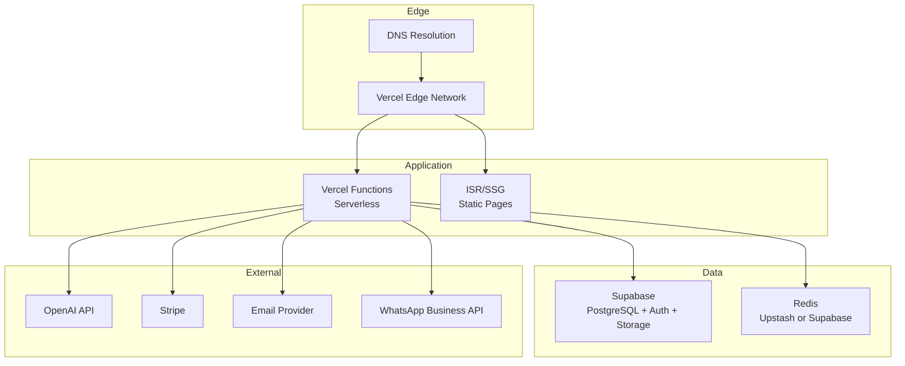

# System Overview

High-level architecture of the Dr. Bubal Care platform.

## High-Level Architecture

```mermaid
graph TB
    subgraph "User Portals"
        P[Patient Portal<br/>patient.drbubalcare.com]
        S[Specialist Portal<br/>doctor.drbubalcare.com]
        A[Admin Portal<br/>admin.drbubalcare.com]
    end

    subgraph "Application Layer"
        FE[Next.js 15 App<br/>React 19 + TypeScript]
        API[API Routes<br/>Next.js Server Actions]
        AUTH[Auth System<br/>NextAuth.js]
    end

    subgraph "AI Services"
        AR[AI Case Routing]
        AP[AI Pre-screening]
        PL[Plain-language Summary]
        MS[Multi-opinion Synthesis]
        FQ[Follow-up Q&A]
        TA[Trend Analysis]
    end

    subgraph "Data Layer"
        DB[(PostgreSQL<br/>Supabase)]
        OBJ[Object Storage<br/>Encrypted Files)]
        REDIS[Cache Layer<br/>Session & Rate Limiting]
    end

    subgraph "External Services"
        OPENAI[OpenAI API]
        STRIPE[Stripe<br/>Payments]
        EMAIL[Email Service<br/>Transactional]
        WA[WhatsApp API<br/>Urgent Alerts]
    end

    P --> FE
    S --> FE
    A --> FE
    FE --> API
    FE --> AUTH
    AUTH --> DB
    API --> DB
    API --> OBJ
    API --> REDIS
    API --> AR
    API --> AP
    API --> PL
    API --> MS
    API --> FQ
    API --> TA
    AR --> OPENAI
    AP --> OPENAI
    PL --> OPENAI
    MS --> OPENAI
    FQ --> OPENAI
    TA --> OPENAI
    API --> STRIPE
    API --> EMAIL
    API --> WA
```

## Component Breakdown

### Frontend Portals

| Portal | URL | Tech | Purpose |
|--------|-----|------|---------|
| Patient | `patient.drbubalcare.com` | Next.js 15, React 19, TailwindCSS, shadcn/ui | Case creation, file upload, opinion viewing, follow-up Q&A |
| Specialist | `doctor.drbubalcare.com` | Next.js 15, React 19, TailwindCSS, shadcn/ui | Case review, opinion writing, availability management |
| Admin | `admin.drbubalcare.com` | Next.js 15, React 19, TailwindCSS, shadcn/ui | Routing oversight, analytics, dispute resolution |

### Backend Services

| Service | Responsibility |
|---------|---------------|
| **API Routes** | Next.js API routes handling all CRUD operations, file uploads, and external integrations |
| **Auth Service** | NextAuth.js handling registration, login, session management, and role-based access |
| **AI Orchestrator** | Coordinates LLM calls, PHI stripping, prompt construction, and output logging |
| **File Service** | Manages encrypted file upload, storage, and signed URL generation |
| **Email Service** | Transactional emails for case updates, verification, notifications |
| **Payment Service** | Stripe integration for case payments and refunds |

### Core Workflows

| Workflow | Trigger | Key Steps |
|----------|---------|-----------|
| **Case Creation** | Patient starts case | Upload records → Payment → AI pre-screening → Case routed |
| **Specialist Review** | Case assigned | View pre-screen → Review records → Write opinion → Sign & submit |
| **Report Delivery** | Opinion signed | Generate plain-language summary → Notify patient → Enable follow-up |
| **Follow-up Q&A** | Patient asks question | Scope check → AI response within opinion scope → Log interaction |
| **Dispute Resolution** | Patient raises dispute | Admin review → Peer review assignment → Resolution |

## Technology Stack

| Layer | Technology | Version | Purpose |
|-------|-----------|---------|---------|
| **Framework** | Next.js | 15.5.20 | Full-stack React framework with App Router |
| **Language** | TypeScript | 5.8 | Type safety across entire stack |
| **UI Library** | React | 19.1 | Component rendering and state management |
| **Styling** | TailwindCSS | 4.x | Utility-first CSS |
| **UI Components** | shadcn/ui | 4.13 | Pre-built accessible components |
| **State Management** | Zustand | 5.0 | Client-side state |
| **Server State** | TanStack Query | 5.101 | Data fetching and caching |
| **Forms** | React Hook Form + Zod | 7.81 / 3.25 | Form validation and schema enforcement |
| **Rich Text** | TipTap | 3.27 | Opinion editor for specialists |
| **Database** | PostgreSQL via Supabase | — | Primary data store |
| **ORM** | Prisma | 7.8 | Type-safe database access |
| **Authentication** | NextAuth.js | 4.24 | Session management and auth |
| **AI SDK** | Vercel AI SDK | 7.0 | LLM integration (OpenAI) |
| **Encryption** | bcryptjs | 3.0 | Password hashing |
| **Charts** | Recharts | 3.9 | Trend visualization |
| **Animation** | Motion (Framer Motion) | 12.4 | UI animations |
| **Validation** | Zod | 3.25 | Runtime schema validation |
| **Testing** | Vitest | 4.1 | Unit and integration tests |
| **Build** | Turbopack | — | Fast dev/build tooling |

## Deployment Architecture



| Infrastructure | Provider | Purpose |
|---------------|----------|---------|
| **Hosting** | Vercel | Edge deployment, serverless functions, ISR |
| **Database** | Supabase (PostgreSQL) | Primary database, row-level security, real-time |
| **Object Storage** | Supabase Storage | Encrypted file storage for case records |
| **Cache** | Upstash Redis | Session caching, rate limiting, queue management |
| **AI** | OpenAI (via Vercel AI SDK) | LLM calls for all 6 AI features |
| **Payments** | Stripe | Case payments, refunds, invoicing |
| **Email** | Transactional provider | Notifications, verification emails |
| **WhatsApp** | WhatsApp Business API | Urgent/critical finding alerts |
