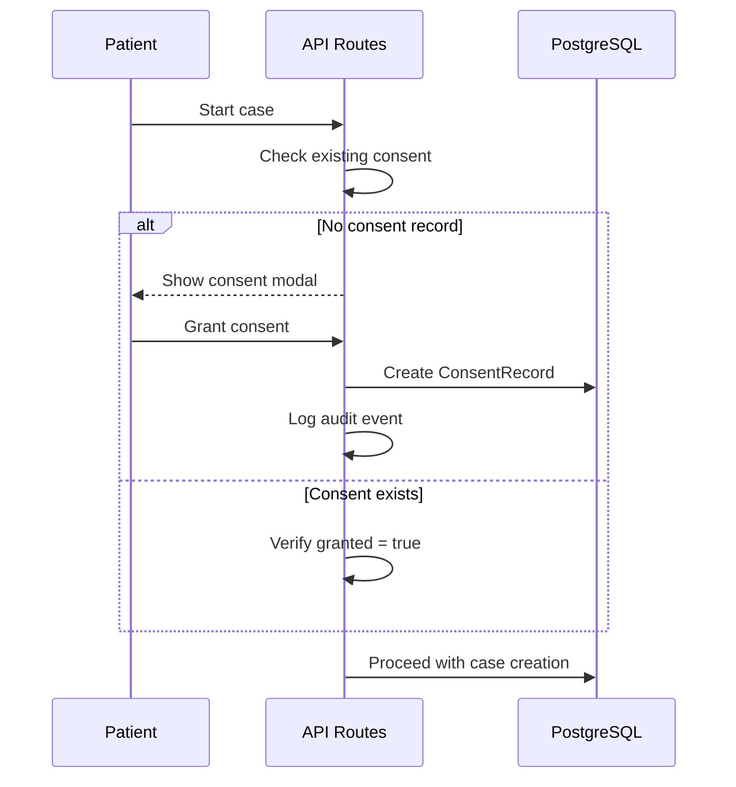
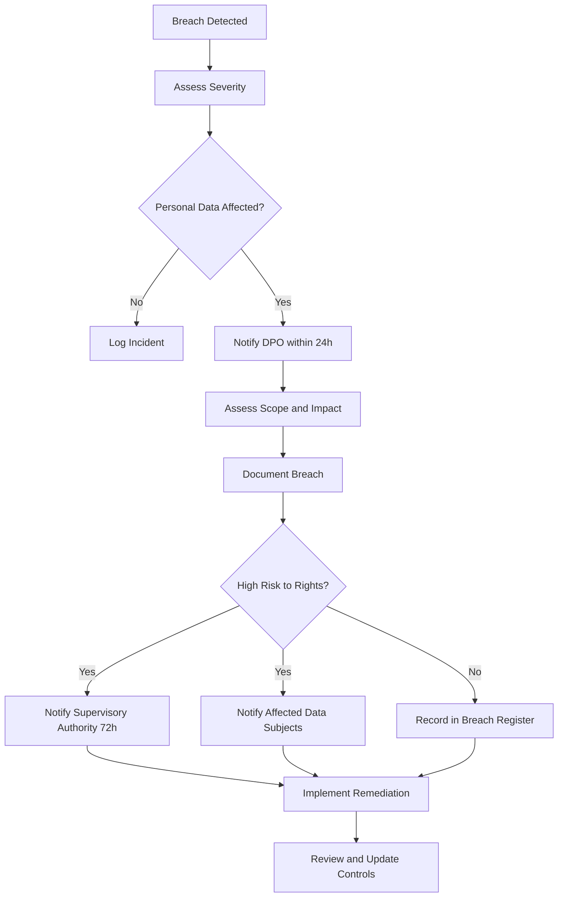

# GDPR Compliance

General Data Protection Regulation (EU 2016/679) compliance procedures for Dr. Bubal Care.

## Overview

Dr. Bubal Care processes personal data including health-related information (special category data) for patients using the diagnostic coordination platform. This document outlines GDPR compliance obligations and implementation details.

**Legal basis:** Processing relies on explicit patient consent (Article 6(1)(a) and Article 9(2)(a)) and, where applicable, the provision of health services (Article 9(2)(h)).

**DPO Contact:** [Data Protection Officer email] — to be designated before production launch.

---

## Data Subject Rights

### Right of Access (Article 15)

Patients can request a copy of all personal data held about them.

| Data Included | Source | Format |
|---------------|--------|--------|
| Account profile (name, email) | `User` model | JSON export |
| Cases and case records | `Case`, `CaseRecord` | JSON + file archive |
| Specialist opinions | `SpecialistOpinion` | JSON + PDF |
| AI-generated outputs | `AIPrescreen`, `PlainLanguageSummary`, `TrendAnalysis` | JSON |
| Follow-up Q&A | `FollowUpQuestion` | JSON |
| Consent records | `ConsentRecord` | JSON |
| Audit logs | `AuditLog` | CSV |

**Implementation:**

```typescript
// POST /api/patient/data-export
async function requestDataExport(patientId: string) {
  const user = await prisma.user.findUnique({ where: { id: patientId } });
  const cases = await prisma.case.findMany({
    where: { patientId },
    include: {
      records: true,
      opinions: {
        include: { plainSummary: true, followUps: true },
      },
      aiPrescreens: true,
    },
  });
  const labResults = await prisma.labResult.findMany({
    where: { patientId },
    include: { metrics: true, trends: true },
  });
  const consentRecords = await prisma.consentRecord.findMany({
    where: { patientId },
  });

  const exportData = { user, cases, labResults, consentRecords };
  const jsonData = JSON.stringify(exportData, null, 2);
  const fileUrl = await uploadToStorage(patientId, jsonData);

  await logAudit(patientId, 'DATA_EXPORT_REQUEST', 'User', patientId);
  return { downloadUrl: fileUrl, expiresAt: addHours(new Date(), 24) };
}
```

### Right to Erasure (Article 17)

Patients can request permanent deletion of all personal data.

| Data Handled | Action | Retention Exception |
|-------------|--------|-------------------|
| Account profile | Delete user record | — |
| Cases | Anonymize patient reference | — |
| Case records (files) | Delete from storage | — |
| Specialist opinions | Anonymize (specialist work retained) | — |
| Lab results | Delete | — |
| Consent records | Retain for compliance audit | 7 years |
| Audit logs | Anonymize user reference | 7 years (regulatory) |

**Implementation via `DataDeletionRequest` model:**

```typescript
// POST /api/patient/delete-request
async function requestDeletion(patientId: string) {
  const existing = await prisma.dataDeletionRequest.findFirst({
    where: { patientId, status: { in: ['PENDING', 'CONFIRMED'] } },
  });
  if (existing) {
    throw new Error('Deletion already in progress');
  }

  const request = await prisma.dataDeletionRequest.create({
    data: {
      patientId,
      status: 'PENDING',
      requestedAt: new Date(),
      executeAt: addDays(new Date(), 30), // 30-day grace period
    },
  });

  await logAudit(patientId, 'DELETION_REQUESTED', 'DataDeletionRequest', request.id);
  return request;
}

// Executes after grace period confirmation
async function executeDeletion(requestId: string) {
  const request = await prisma.dataDeletionRequest.findUnique({
    where: { id: requestId },
  });
  if (!request || request.status !== 'CONFIRMED') return;

  // Delete in order respecting foreign keys
  await prisma.$transaction(async (tx) => {
    // Delete follow-up questions
    await tx.followUpQuestion.deleteMany({
      where: { opinion: { case: { patientId: request.patientId } } },
    });
    // Delete plain summaries
    await tx.plainLanguageSummary.deleteMany({
      where: { opinion: { case: { patientId: request.patientId } } },
    });
    // Delete opinions (anonymize specialist work)
    await tx.specialistOpinion.updateMany({
      where: { case: { patientId: request.patientId } },
      data: { specialistId: 'ANONYMOUS' },
    });
    // Delete case records
    await tx.caseRecord.deleteMany({
      where: { case: { patientId: request.patientId } },
    });
    // Delete cases
    await tx.case.deleteMany({ where: { patientId: request.patientId } });
    // Delete lab data
    await tx.labResult.deleteMany({ where: { patientId: request.patientId } });
    // Delete trend analyses
    await tx.trendAnalysis.deleteMany({ where: { patientId: request.patientId } });
    // Delete user
    await tx.user.delete({ where: { id: request.patientId } });
  });

  await prisma.dataDeletionRequest.update({
    where: { id: requestId },
    data: { status: 'COMPLETED', completedAt: new Date() },
  });
}
```

### Right to Rectification (Article 16)

Patients can request correction of inaccurate personal data.

| Data Type | Correction Method | Restrictions |
|-----------|-------------------|-------------|
| Name, email | Patient edits in profile | — |
| Clinical records | Patient re-uploads | Original retained in audit |
| Case description | Patient edits open cases | Cannot modify after opinion signed |

### Right to Data Portability (Article 20)

Patients can receive their data in a structured, commonly used, machine-readable format.

| Format | Scope |
|--------|-------|
| JSON | Full data export (see Right of Access) |
| PDF | Specialist opinions and plain-language summaries |
| CSV | Audit log of personal data access |

---

## Consent Management

### Consent Types

| Consent Type | Description | Required | Model Field |
|-------------|-------------|----------|-------------|
| `AI_PROCESSING` | Allows AI features to process clinical data (PHI-stripped) | Yes for AI features | `ConsentRecord` |
| `DATA_STORAGE` | Stores clinical records on platform servers | Yes | `ConsentRecord` |
| `FOLLOW_UP_COMMUNICATIONS` | Allows follow-up questions via AI assistant | No | `ConsentRecord` |
| `MARKETING` | Platform announcements and updates | No | `ConsentRecord` |

### Consent Flow



### Consent Model

```prisma
model ConsentRecord {
  id          String   @id @default(cuid())
  patientId   String
  consentType String
  granted     Boolean
  grantedAt   DateTime?
  revokedAt   DateTime?

  patient     User     @relation(fields: [patientId], references: [id], onDelete: Cascade)

  @@unique([patientId, consentType])
}
```

### Consent Revocation

Patients can revoke consent at any time. Revocation does not retroactively invalidate previously processed data but stops future processing.

```typescript
async function revokeConsent(patientId: string, consentType: string) {
  const record = await prisma.consentRecord.update({
    where: { patientId_consentType: { patientId, consentType } },
    data: { granted: false, revokedAt: new Date() },
  });

  await logAudit(patientId, 'CONSENT_REVOKED', 'ConsentRecord', record.id, {
    consentType,
  });

  // If AI processing consent revoked, pause AI features for this patient
  if (consentType === 'AI_PROCESSING') {
    await pauseAIFeatures(patientId);
  }

  return record;
}
```

---

## Data Processing Legal Basis

| Processing Activity | Legal Basis (Art. 6) | Special Category Basis (Art. 9) |
|---------------------|---------------------|-------------------------------|
| Account management | Consent (6(1)(a)) | — |
| Case processing | Consent (6(1)(a)) | Explicit consent (9(2)(a)) |
| AI pre-screening | Consent (6(1)(a)) | Explicit consent (9(2)(a)) |
| Specialist opinion delivery | Consent (6(1)(a)) | Explicit consent (9(2)(a)) |
| Lab result interpretation | Consent (6(1)(a)) | Explicit consent (9(2)(a)) |
| Legal obligation compliance | Legal obligation (6(1)(c)) | — |
| Platform security | Legitimate interest (6(1)(f)) | — |

---

## Data Minimization

| Data Collected | Purpose | Minimized Version |
|---------------|---------|-------------------|
| Patient name | Account identification | Not sent to AI models |
| Date of birth | Age context | Generalized to "adult" for AI |
| MRN | Medical record reference | Replaced with opaque token |
| Insurance ID | Payment processing | Never sent to AI models |
| Phone number | Urgent notifications | Stored separately, not in case data |
| Email | Authentication | Not included in clinical data |
| Address | Billing | Not included in clinical data |
| Hospital name | Context | Generalized to "referring facility" for AI |
| Admission dates | Clinical timeline | Converted to relative time for AI |

---

## Storage Limitation

| Data Type | Retention Period | Justification |
|-----------|-----------------|---------------|
| User accounts | Until deletion requested | Core service requirement |
| Clinical records | Until deletion requested | Core service requirement |
| Specialist opinions | Until deletion requested | Professional record-keeping |
| Audit logs | 7 years | Regulatory compliance (HIPAA, GDPR) |
| AI prompts/outputs | 7 years (no PHI) | Audit trail requirement |
| Consent records | 7 years | Proof of consent |
| Payment records | Per Stripe policy (7 years) | Financial regulations |
| Session data | 30 days | Security best practice |
| Data deletion requests | 7 years | Proof of compliance |

---

## Breach Notification

### Breach Response Procedure



### Notification Timelines

| Action | Deadline | Recipient |
|--------|----------|-----------|
| Internal assessment | 24 hours | DPO, CTO |
| Supervisory authority notification | 72 hours | Lead data protection authority |
| Data subject notification | Without undue delay | Affected patients |
| Documentation in breach register | Immediately | Internal record |

### Breach Register Fields

| Field | Description |
|-------|-------------|
| Breach ID | Unique identifier |
| Date discovered | When breach was found |
| Date occurred | When breach actually happened |
| Description | Nature of the breach |
| Data types affected | Categories of personal data |
| Approximate number | How many data subjects affected |
| Likely consequences | What could happen to affected persons |
| Measures taken | Steps to address the breach |
| Notifications sent | Who was notified and when |

---

## International Transfers

### Data Flow Locations

| Data Type | Storage Location | Transfer Mechanism |
|-----------|-----------------|-------------------|
| User data | Supabase (PostgreSQL) | EU/US data residency |
| Clinical files | Supabase Storage | EU/US data residency |
| AI processing | OpenAI API | Standard Contractual Clauses (SCCs) |
| Email notifications | Email provider | Adequacy decision / SCCs |
| Payment processing | Stripe | Adequacy decision / SCCs |

### Safeguards for International Transfers

| Transfer | Safeguard | Status |
|----------|-----------|--------|
| OpenAI (US) | Standard Contractual Clauses | Required before launch |
| Stripe (US) | Adequacy decision + SCCs | In place |
| Supabase | EU data region option | Available |

---

## Related Documentation

- [Security Model](../architecture/security-model.md) — PHI protection, encryption, RBAC
- [Audit Logging](./audit-logging.md) — Compliance logging implementation
- [Database Schema](../database/schema-reference.md) — `ConsentRecord`, `DataDeletionRequest` models
- [Enums](../database/enums.md) — `DeletionStatus` state machine
