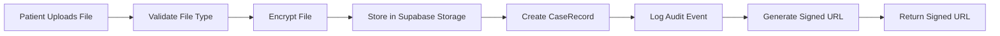
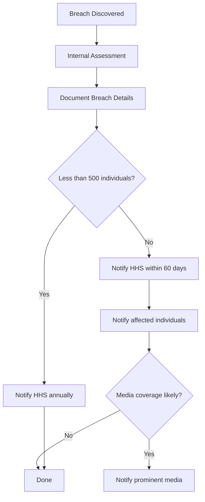

# HIPAA Compliance

Health Insurance Portability and Accountability Act (HIPAA) compliance procedures for Dr. Bubal Care.

## Overview

Dr. Bubal Care processes Protected Health Information (PHI) as a covered entity and/or business associate. This document outlines HIPAA compliance obligations covering the Privacy Rule, Security Rule, and Breach Notification Rule.

**Applicability:** Dr. Bubal Care receives PHI from patients (lab results, imaging, clinical records) and stores it on behalf of patients for specialist review.

---

## PHI Definition and Handling

### What Constitutes PHI on the Platform

| PHI Category | Examples on Platform | Storage Location | Access Level |
|-------------|---------------------|-----------------|-------------|
| **Patient identifiers** | Name, email, date of birth | `User` model | Patient, Admin |
| **Medical record numbers** | MRN, insurance ID | `Case.description`, files | Patient, Specialist (assigned), Admin |
| **Clinical records** | Slides, DICOM scans, reports | `CaseRecord` (Supabase Storage) | Patient, Specialist (assigned), Admin |
| **Lab results** | Test names, values, dates | `LabResult`, `LabMetric` | Patient, Admin |
| **Clinical findings** | Specialist opinions, pre-screens | `SpecialistOpinion`, `AIPrescreen` | Patient (own), Specialist (assigned), Admin |
| **Diagnostic data** | Case descriptions, clinical context | `Case.description` | Patient, Specialist (assigned), Admin |
| **Trend analyses** | Longitudinal health data | `TrendAnalysis` | Patient, Admin |

### PHI Handling Rules

| Rule | Implementation |
|------|---------------|
| **Minimum necessary** | AI features process only clinical data needed for the specific task — never full patient record |
| **Access logging** | Every PHI access logged in `AuditLog` (who, what, when) |
| **Encryption at rest** | AES-256 via Supabase Storage; PostgreSQL TDE |
| **Encryption in transit** | TLS 1.3 for all data transmission |
| **PHI stripping** | Identifiable data removed before any LLM call (see [AI Feature Layer](../architecture/ai-feature-layer.md)) |
| **Signed URLs** | Short-lived (15 min) URLs for file access — expire after extraction |
| **No PHI in AI prompts** | Names, DOB, MRN, contact info never sent to LLMs |
| **Audit trail** | All PHI access logged with timestamps and user attribution |

---

## Administrative Safeguards

### Security Management Process

| Safeguard | Implementation | Status |
|-----------|---------------|--------|
| **Risk analysis** | Identifies threats to ePHI across all system components | Required pre-launch |
| **Risk management** | Implements controls to reduce identified risks to acceptable level | Ongoing |
| **Sanction policy** | Applies appropriate sanctions for policy violations | HR policy required |
| **Information system activity review** | Regular review of audit logs and security reports | Weekly review |

### Workforce Security

| Safeguard | Implementation |
|-----------|---------------|
| **Authorization and supervision** | Role-based access control (RBAC) — see [Security Model](../architecture/security-model.md) |
| **Workforce clearance** | Background verification for specialists before platform access |
| **Termination procedures** | Immediate access revocation upon role change or departure |

### Security Awareness Training

| Training | Audience | Frequency |
|----------|----------|-----------|
| HIPAA basics | All users | Onboarding |
| PHI handling | Specialists, Admins | Onboarding + annual refresher |
| Incident reporting | All users | Onboarding |
| AI safety principles | Specialists | Onboarding |

### Security Incident Procedures

| Phase | Action | Owner |
|-------|--------|-------|
| **Detection** | Automated monitoring alerts + user reports | System / Users |
| **Response** | Assess scope, contain breach, preserve evidence | CTO + DPO |
| **Recovery** | Restore services, patch vulnerabilities | Engineering |
| **Notification** | Notify affected parties per breach policy | DPO + Legal |
| **Review** | Post-incident analysis, update controls | CTO + DPO |

### Contingency Plan

| Component | Strategy |
|-----------|----------|
| **Data backup** | Daily automated backups via Supabase |
| **Disaster recovery** | Supabase point-in-time recovery; target RTO < 4 hours |
| **Emergency mode** | Fallback to read-only mode for critical operations |
| **Testing and revision** | Quarterly disaster recovery tests |

---

## Physical Safeguards

Dr. Bubal Care operates as a cloud-native application. Physical safeguards are primarily managed by infrastructure providers.

| Safeguard | Implementation | Provider |
|-----------|---------------|----------|
| **Facility access controls** | Cloud data center physical security | Supabase (AWS/GCP) |
| **Workstation use** | No local PHI storage — all access via web browser | Platform policy |
| **Workstation security** | HTTPS-only, no local PHI caching | Application design |
| **Device and media controls** | Encrypted storage, signed URLs for file access | Supabase + Application |

### Cloud Provider Compliance

| Provider | Certifications | Data Location |
|----------|---------------|---------------|
| **Supabase** | SOC 2 Type II, ISO 27001 | EU/US (configurable) |
| **Vercel** | SOC 2 Type II | Global edge network |
| **OpenAI** | SOC 2 Type II | US (with SCCs) |

---

## Technical Safeguards

### Access Controls

| Control | Implementation |
|---------|---------------|
| **Unique user identification** | Every user has unique `id` (CUID) |
| **Emergency access** | Admin override capability with full audit logging |
| **Automatic logoff** | Session timeout after 30 minutes of inactivity |
| **Authentication** | NextAuth.js with bcryptjs password hashing (cost factor 12) |
| **Authorization** | Row-level security (RLS) in Supabase; role-based API access |

```sql
-- Row-Level Security: Patient can only read own data
CREATE POLICY "patient_own_cases" ON cases
  FOR SELECT USING (patient_id = auth.uid());

-- Row-Level Security: Specialist can only read assigned cases
CREATE POLICY "specialist_assigned_cases" ON cases
  FOR SELECT USING (specialist_id = auth.uid());

-- Row-Level Security: Admin can read all cases
CREATE POLICY "admin_all_cases" ON cases
  FOR SELECT USING (
    EXISTS (SELECT 1 FROM users WHERE id = auth.uid() AND role = 'ADMIN')
  );
```

### Audit Controls

| Control | Implementation |
|---------|---------------|
| **Audit logging** | Every PHI access logged in `AuditLog` model |
| **Integrity controls** | Immutable audit log entries (no update/delete) |
| **Activity review** | Weekly audit log review by admin |
| **Alert rules** | Automated alerts for suspicious access patterns |

See [Audit Logging](./audit-logging.md) for full implementation details.

### Integrity Controls

| Control | Implementation |
|---------|---------------|
| **Data validation** | Zod schemas validate all API inputs |
| **Database constraints** | Foreign keys, unique constraints, not-null checks |
| **File validation** | File type verification on upload; malformed files rejected |
| **PHI stripping validation** | Output scanner verifies no PHI leaked to AI prompts |

### Transmission Security

| Control | Implementation |
|---------|---------------|
| **TLS 1.3** | All HTTP communication encrypted |
| **Signed URLs** | Short-lived (15 min) for file access |
| **API key security** | Environment variables, never in code |
| **CORS policy** | Restrict origins to platform domains |

---

## Business Associate Agreements

Dr. Bubal Care must execute BAAs with all vendors that handle PHI.

| Vendor | Service | BAA Status | Data Handled |
|--------|---------|------------|-------------|
| **Supabase** | Database, file storage | Required | PHI (clinical records, patient data) |
| **Vercel** | Application hosting | Required | PHI in transit (server-side processing) |
| **OpenAI** | AI feature processing | Required | PHI-stripped clinical data only |
| **Stripe** | Payment processing | Required | No PHI (payment data only) |
| **Email provider** | Notifications | Required | No PHI (transactional emails only) |

### BAA Requirements

| Requirement | Implementation |
|-------------|---------------|
| PHI use limitations | Vendors may only use PHI for contracted services |
| Disclosure restrictions | Vendors may not disclose PHI without authorization |
| Safeguard requirements | Vendors must implement HIPAA-compliant security |
| Breach notification | Vendors must notify within 60 days of breach |
| Subcontractor requirements | Vendors must ensure subcontractors comply |
| Return/destruction | Vendors must return or destroy PHI upon termination |

---

## PHI Handling Procedures

### Uploading PHI



| Step | Security Measure |
|------|-----------------|
| Upload | HTTPS encrypted in transit |
| Storage | AES-256 encryption at rest |
| Access | Signed URL with 15-minute expiry |
| Logging | Upload event logged with timestamp, file type, file size |

### Accessing PHI

| User Type | What They Can Access | Conditions |
|-----------|---------------------|------------|
| **Patient** | Own cases, opinions, lab results | Session authenticated, own patientId |
| **Specialist** | Assigned case records, AI pre-screens | Assigned to case, session authenticated |
| **Admin** | All cases, audit logs | Admin role verified |

### AI Processing of PHI

All AI features follow the PHI stripping pipeline before any LLM call:

```typescript
// PHI Stripping Pipeline — see AI Feature Layer for full implementation
function processForAI(clinicalData: ClinicalData): StrippedData {
  return {
    name: undefined,           // Removed
    dateOfBirth: undefined,    // Removed
    mrn: undefined,            // Removed
    contactInfo: undefined,    // Removed
    facility: "Referring facility", // Generalized
    temporalContext: computeRelativeTime(clinicalData.dates), // Relative
    // Clinical content preserved
    chiefComplaint: clinicalData.chiefComplaint,
    findings: clinicalData.findings,
    labValues: clinicalData.labValues,
  };
}
```

### Sharing PHI with Specialists

| Step | Description | Security |
|------|-------------|----------|
| 1 | Case assigned to specialist | SpecialistId linked via secure routing |
| 2 | Specialist accesses case | RLS policy verifies assignment |
| 3 | Specialist views records | Signed URL, 15-minute expiry |
| 4 | Specialist writes opinion | Opinion stored encrypted |
| 5 | Opinion delivered to patient | Access logged in AuditLog |

---

## Breach Response

### HIPAA Breach Definition

An impermissible use or disclosure under the Privacy Rule that compromises the security or privacy of PHI, unless the organization demonstrates a low probability that the PHI was compromised.

### Breach Assessment Factors

| Factor | Assessment |
|--------|-----------|
| Nature and extent of PHI involved | Types of identifiers, clinical sensitivity |
| Unauthorized person who used/accessed PHI | Employee, vendor, external attacker |
| Whether PHI was actually acquired/viewed | Evidence from audit logs |
| Extent of risk mitigation | Steps taken to reduce harm |

### Breach Notification Process



| Notification | Recipient | Deadline | Method |
|-------------|-----------|----------|--------|
| **Individual notice** | Affected patients | Without unreasonable delay, no later than 60 days | Written notice (email or mail) |
| **HHS notice (≥500)** | Secretary of HHS | Within 60 days | HHS breach portal |
| **HHS notice (<500)** | Secretary of HHS | Within 60 days of calendar year end | HHS breach portal |
| **Media notice (≥500)** | Prominent media in affected state | Within 60 days | Press release |

### Breach Notification Content

| Element | Description |
|---------|-------------|
| Description | What happened, date of breach, date of discovery |
| Data types | Types of PHI involved (names, lab results, etc.) |
| Steps individuals should take | Monitor statements, place fraud alerts |
| Remediation | What Dr. Bubal Care is doing to address the breach |
| Contact information | DPO phone, email, postal address |
| Toll-free number | For affected individuals to ask questions |

---

## Risk Assessment

### Required Risk Assessment Areas

| Area | Risk Factors | Mitigation |
|------|-------------|-----------|
| **Data storage** | Unauthorized access to Supabase | RLS, encryption, access logging |
| **Data transmission** | Interception of PHI in transit | TLS 1.3, signed URLs |
| **AI processing** | PHI leakage to LLM providers | PHI stripping pipeline, output filtering |
| **User access** | Unauthorized role escalation | RBAC, session management |
| **File handling** | Unauthorized file download | Signed URLs, access logging |
| **Third-party vendors** | Vendor breach exposes PHI | BAAs, vendor security assessment |
| **Insider threats** | Employee misuse of PHI | Audit logging, sanction policy |
| **Incident response** | Delayed breach notification | Automated alerting, documented procedures |

### Risk Assessment Schedule

| Assessment | Frequency | Owner |
|-----------|-----------|-------|
| Initial risk assessment | Pre-launch | CTO + DPO |
| Annual comprehensive assessment | Yearly | CTO + DPO |
| AI feature assessment | Before each new AI feature | CTO |
| Vendor risk assessment | On onboarding + annually | DPO |
| Post-incident assessment | After any security incident | CTO + DPO |

---

## Minimum Necessary Rule

| Access Type | Minimum Necessary Scope |
|------------|------------------------|
| **AI pre-screening** | Only clinical data from case records — no patient identifiers |
| **Specialist review** | Only records attached to assigned case — not full patient history |
| **Admin oversight** | Full access for compliance and incident response |
| **Follow-up Q&A** | Only the specific opinion and question — not other opinions |
| **Trend analysis** | Only the specific lab metric history — not other patient data |

### Implementation

```typescript
// Enforce minimum necessary at API layer
async function getSpecialistCaseAccess(specialistId: string, caseId: string) {
  const assignment = await prisma.case.findFirst({
    where: {
      id: caseId,
      specialistId: specialistId, // Ensures specialist is assigned
    },
    include: {
      records: true,        // Only records for this case
      aiPrescreens: true,   // Only pre-screens for this case
    },
  });

  if (!assignment) {
    await logAudit(specialistId, 'UNAUTHORIZED_CASE_ACCESS', 'Case', caseId);
    throw new ForbiddenError('Not assigned to this case');
  }

  await logAudit(specialistId, 'CASE_ACCESSED', 'Case', caseId);
  return assignment;
}
```

---

## Related Documentation

- [Security Model](../architecture/security-model.md) — PHI protection, encryption, RBAC
- [Audit Logging](./audit-logging.md) — Compliance logging implementation
- [GDPR](./gdpr.md) — GDPR compliance procedures
- [AI Feature Layer](../architecture/ai-feature-layer.md) — PHI stripping pipeline
- [Database Schema](../database/schema-reference.md) — Compliance models
