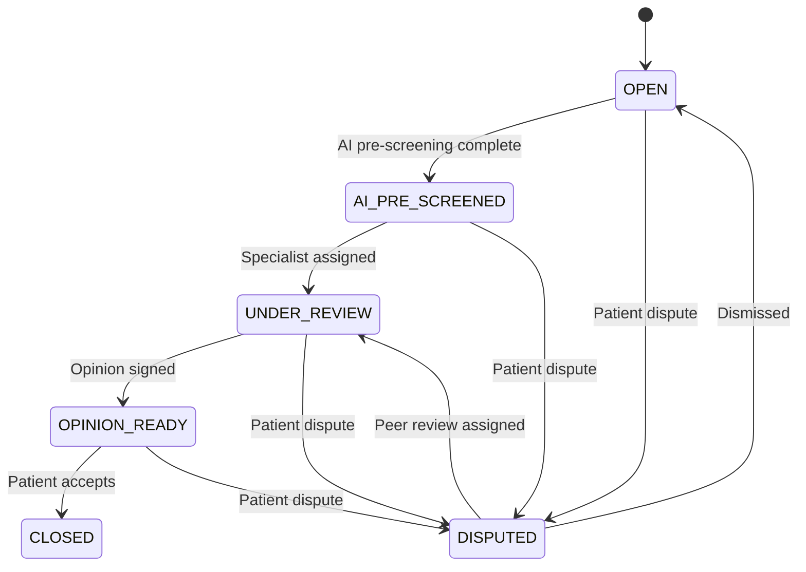
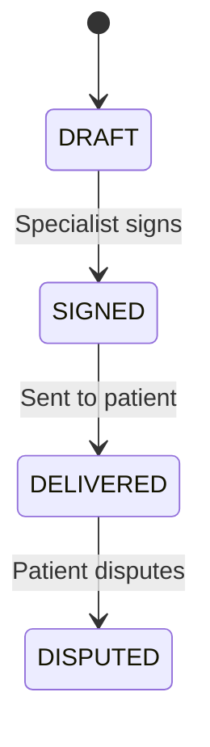
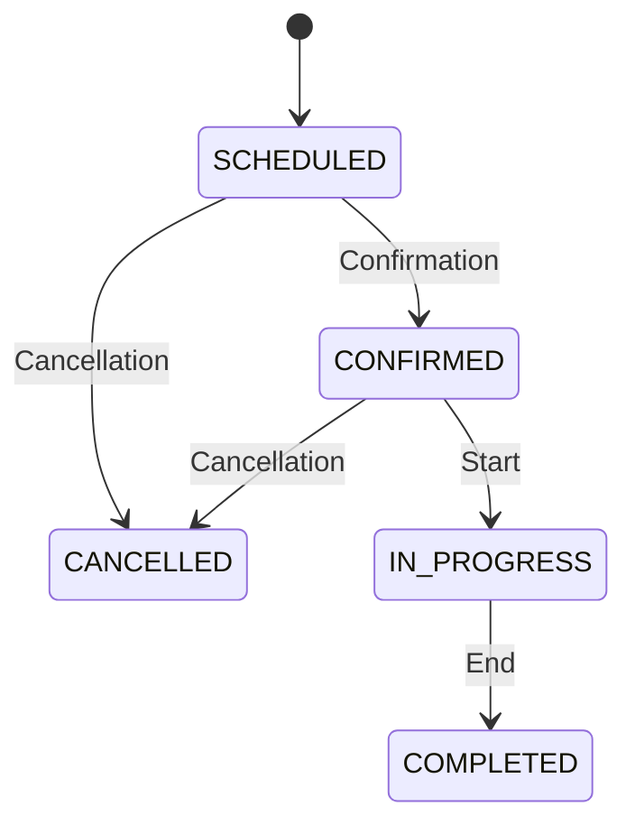
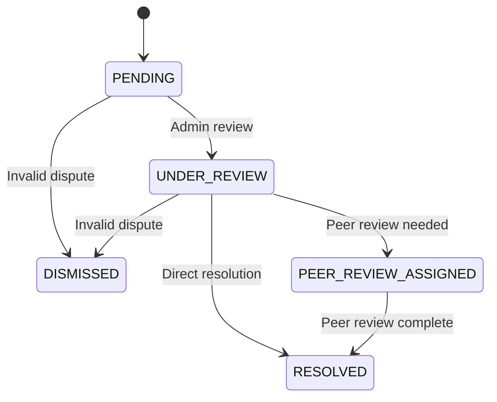
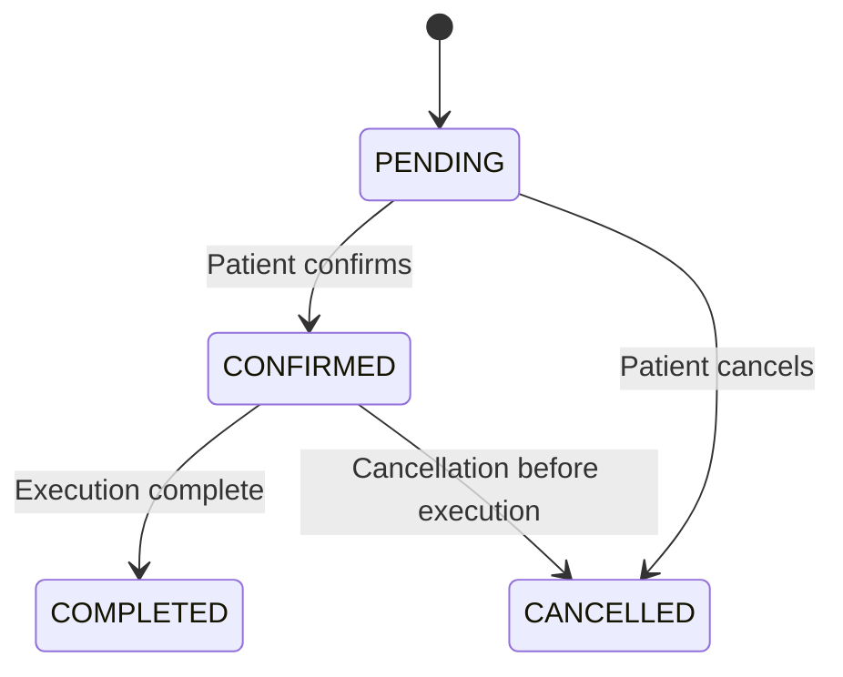

# Enums

All enum definitions, state transitions, and usage guidelines for the Dr. Bubal Care database.

## Enum Definitions

### Role

User roles determining access level and portal assignment.

```prisma
enum Role {
  PATIENT
  DOCTOR
  ADMIN
}
```

| Value | Description | Portal |
|-------|-------------|--------|
| `PATIENT` | End user seeking diagnostic opinions | `patient.drbubalcare.com` |
| `DOCTOR` | Board-certified specialist providing opinions | `doctor.drbubalcare.com` |
| `ADMIN` | Platform administrator with full access | `admin.drbubalcare.com` |

---

### CaseStatus

Tracks the lifecycle of a diagnostic case.

```prisma
enum CaseStatus {
  OPEN
  AI_PRE_SCREENED
  UNDER_REVIEW
  OPINION_READY
  CLOSED
  DISPUTED
}
```

| Value | Description | Next States |
|-------|-------------|-------------|
| `OPEN` | Case created, awaiting AI pre-screening | `AI_PRE_SCREENED` |
| `AI_PRE_SCREENED` | AI pre-screening complete, awaiting specialist | `UNDER_REVIEW` |
| `UNDER_REVIEW` | Specialist reviewing case materials | `OPINION_READY` |
| `OPINION_READY` | Specialist opinion signed and delivered | `CLOSED` |
| `CLOSED` | Case completed | — |
| `DISPUTED` | Patient raised dispute | Any (after resolution) |

#### State Transitions



---

### OpinionStatus

Tracks the lifecycle of a specialist opinion.

```prisma
enum OpinionStatus {
  DRAFT
  SIGNED
  DELIVERED
  DISPUTED
}
```

| Value | Description | Next States |
|-------|-------------|-------------|
| `DRAFT` | Opinion being written by specialist | `SIGNED` |
| `SIGNED` | Specialist has signed the opinion | `DELIVERED` |
| `DELIVERED` | Opinion delivered to patient | `DISPUTED` |
| `DISPUTED` | Opinion disputed by patient | — |

#### State Transitions



---

### ServiceType

Types of diagnostic services offered on the platform.

```prisma
enum ServiceType {
  SPECIALIST_OPINION
  RESULT_INTERPRETATION
  FOLLOW_UP
  TREND_ANALYSIS
}
```

| Value | Description | Typical Use |
|-------|-------------|-------------|
| `SPECIALIST_OPINION` | Full specialist review of uploaded materials | Slides, scans, reports |
| `RESULT_INTERPRETATION` | Plain-language explanation of existing results | Lab reports, imaging results |
| `FOLLOW_UP` | Follow-up consultation after initial opinion | Questions about report |
| `TREND_ANALYSIS` | Longitudinal lab test trend analysis | Repeat lab tests over time |

---

### AppointmentStatus

Tracks appointment lifecycle.

```prisma
enum AppointmentStatus {
  SCHEDULED
  CONFIRMED
  IN_PROGRESS
  COMPLETED
  CANCELLED
}
```

| Value | Description | Next States |
|-------|-------------|-------------|
| `SCHEDULED` | Appointment booked, awaiting confirmation | `CONFIRMED`, `CANCELLED` |
| `CONFIRMED` | Both parties confirmed | `IN_PROGRESS`, `CANCELLED` |
| `IN_PROGRESS` | Consultation in progress | `COMPLETED` |
| `COMPLETED` | Consultation finished | — |
| `CANCELLED` | Appointment cancelled | — |

#### State Transitions



---

### LabStatus

Overall status of a lab result.

```prisma
enum LabStatus {
  NORMAL
  REVIEW_NEEDED
}
```

| Value | Description |
|-------|-------------|
| `NORMAL` | All metrics within reference ranges |
| `REVIEW_NEEDED` | One or more metrics outside reference ranges |

---

### MetricStatus

Individual lab metric status.

```prisma
enum MetricStatus {
  NORMAL
  HIGH
  LOW
}
```

| Value | Description |
|-------|-------------|
| `NORMAL` | Value within reference range |
| `HIGH` | Value above reference range |
| `LOW` | Value below reference range |

---

### SynthesisStatus

Multi-opinion synthesis status.

```prisma
enum SynthesisStatus {
  PENDING
  GENERATED
  DELIVERED
}
```

| Value | Description | Next States |
|-------|-------------|-------------|
| `PENDING` | Waiting for multiple opinions | `GENERATED` |
| `GENERATED` | Synthesis complete, awaiting delivery | `DELIVERED` |
| `DELIVERED` | Synthesis sent to patient | — |

---

### DisputeStatus

Dispute resolution lifecycle.

```prisma
enum DisputeStatus {
  PENDING
  UNDER_REVIEW
  PEER_REVIEW_ASSIGNED
  RESOLVED
  DISMISSED
}
```

| Value | Description | Next States |
|-------|-------------|-------------|
| `PENDING` | Dispute filed, awaiting admin review | `UNDER_REVIEW`, `DISMISSED` |
| `UNDER_REVIEW` | Admin reviewing dispute | `PEER_REVIEW_ASSIGNED`, `RESOLVED`, `DISMISSED` |
| `PEER_REVIEW_ASSIGNED` | Peer review assigned to another specialist | `RESOLVED` |
| `RESOLVED` | Dispute resolved | — |
| `DISMISSED` | Dispute dismissed | — |

#### State Transitions



---

### DeletionStatus

GDPR data deletion request lifecycle.

```prisma
enum DeletionStatus {
  PENDING
  CONFIRMED
  COMPLETED
  CANCELLED
}
```

| Value | Description | Next States |
|-------|-------------|-------------|
| `PENDING` | Deletion requested, awaiting confirmation | `CONFIRMED`, `CANCELLED` |
| `CONFIRMED` | Deletion confirmed, scheduled for execution | `COMPLETED`, `CANCELLED` |
| `COMPLETED` | Data permanently deleted | — |
| `CANCELLED` | Deletion cancelled | — |

#### State Transitions



---

## Usage Guidelines

### State Management

- **Never skip states:** Always follow the defined transition paths
- **Log transitions:** Record all state changes in `AuditLog`
- **Validate transitions:** Check current state before allowing transitions
- **Handle edge cases:** Use `DISPUTED` state for any unresolved issues

### Best Practices

1. **Use enums consistently:** Always reference enum values, never raw strings
2. **Default values:** Set sensible defaults for new records
3. **State validation:** Validate state transitions in application logic
4. **Audit logging:** Log all state changes for compliance
5. **Error handling:** Handle invalid transitions gracefully

### Common Patterns

```typescript
// Check if a state transition is valid
function isValidCaseTransition(from: CaseStatus, to: CaseStatus): boolean {
  const validTransitions: Record<CaseStatus, CaseStatus[]> = {
    OPEN: ['AI_PRE_SCREENED', 'DISPUTED'],
    AI_PRE_SCREENED: ['UNDER_REVIEW', 'DISPUTED'],
    UNDER_REVIEW: ['OPINION_READY', 'DISPUTED'],
    OPINION_READY: ['CLOSED', 'DISPUTED'],
    CLOSED: [],
    DISPUTED: ['OPEN', 'UNDER_REVIEW'],
  }
  return validTransitions[from].includes(to)
}
```
