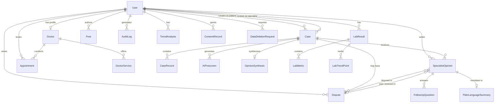

# Relationships

Entity relationships, cascade behaviors, and index strategy for the Dr. Bubal Care database.

## Entity Relationship Diagram



## Relationship Tables

### One-to-One Relationships

| Parent | Child | Foreign Key | Relation Name | Cascade |
|--------|-------|-------------|---------------|---------|
| `User` | `Doctor` | `Doctor.userId` | — | `Cascade` |
| `Case` | `OpinionSynthesis` | `OpinionSynthesis.caseId` | — | `Cascade` |
| `SpecialistOpinion` | `PlainLanguageSummary` | `PlainLanguageSummary.opinionId` | — | `Cascade` |

### One-to-Many Relationships

| Parent | Children | Foreign Key | Relation Name | Cascade |
|--------|----------|-------------|---------------|---------|
| `User` | `Case[]` | `Case.patientId` | `PatientCases` | `Cascade` |
| `User` | `Case[]` | `Case.specialistId` | `SpecialistCases` | `SetNull` |
| `User` | `SpecialistOpinion[]` | `SpecialistOpinion.specialistId` | — | `Cascade` |
| `User` | `Appointment[]` | `Appointment.patientId` | `PatientAppointments` | `Cascade` |
| `User` | `LabResult[]` | `LabResult.patientId` | — | `Cascade` |
| `User` | `Post[]` | `Post.authorId` | — | `Cascade` |
| `User` | `AuditLog[]` | `AuditLog.userId` | — | `Cascade` |
| `User` | `TrendAnalysis[]` | `TrendAnalysis.patientId` | — | `Cascade` |
| `User` | `Dispute[]` | `Dispute.patientId` | — | `Cascade` |
| `User` | `ConsentRecord[]` | `ConsentRecord.patientId` | — | `Cascade` |
| `User` | `DataDeletionRequest[]` | `DataDeletionRequest.patientId` | — | `Cascade` |
| `Doctor` | `DoctorService[]` | `DoctorService.doctorId` | — | `Cascade` |
| `Doctor` | `Appointment[]` | `Appointment.doctorId` | `DoctorAppointments` | `Cascade` |
| `Case` | `CaseRecord[]` | `CaseRecord.caseId` | — | `Cascade` |
| `Case` | `SpecialistOpinion[]` | `SpecialistOpinion.caseId` | — | `Cascade` |
| `Case` | `AIPrescreen[]` | `AIPrescreen.caseId` | — | `Cascade` |
| `Case` | `Dispute[]` | `Dispute.caseId` | — | `Cascade` |
| `SpecialistOpinion` | `FollowUpQuestion[]` | `FollowUpQuestion.opinionId` | — | `Cascade` |
| `LabResult` | `LabMetric[]` | `LabMetric.labResultId` | — | `Cascade` |
| `LabResult` | `LabTrendPoint[]` | `LabTrendPoint.labResultId` | — | `Cascade` |

### Many-to-Many Relationships

| Entity A | Entity B | Through | Notes |
|----------|----------|---------|-------|
| `User` | `Case` | Direct (two FKs) | Patient and specialist roles on same case |

---

## Cascade Behaviors

### Cascade Delete

When a parent record is deleted, all child records are automatically deleted.

| Parent | Children Affected | Business Impact |
|--------|-------------------|-----------------|
| `User` (Patient) | Cases, opinions, labs, appointments, audit logs, disputes, consents, deletion requests | Full patient data removal |
| `User` (Doctor) | Doctor profile, services, appointments, opinions | Specialist data removal |
| `Case` | Records, opinions, pre-screens, synthesis, disputes | Case data removal |
| `SpecialistOpinion` | Plain language summary, follow-up questions | Opinion data removal |
| `LabResult` | Metrics, trend points | Lab data removal |

### Set Null

When a parent record is deleted, the foreign key is set to null.

| Parent | Child FK | Business Impact |
|--------|----------|-----------------|
| `User` (Specialist) | `Case.specialistId` | Case remains but specialist unassigned |

### Business Rules for Deletion

1. **Patient deletion:** Must process GDPR Article 17 request before deletion
2. **Doctor deletion:** Must transfer or reassign active cases first
3. **Case deletion:** Only allowed for `CLOSED` cases older than retention period
4. **Opinion deletion:** Never delete signed opinions — use soft delete instead

---

## Index Strategy

### Primary Keys

All models use `String` IDs with `@default(cuid())` for:
- Globally unique identifiers
- URL-safe encoding
- No sequential guessing (security)

### Unique Constraints

| Model | Fields | Purpose |
|-------|--------|---------|
| `User` | `email` | Login uniqueness |
| `Doctor` | `userId` | One doctor profile per user |
| `Post` | `slug` | URL-friendly identifiers |
| `OpinionSynthesis` | `caseId` | One synthesis per case |
| `PlainLanguageSummary` | `opinionId` | One summary per opinion |
| `Dispute` | `opinionId` | One dispute per opinion |
| `Dispute` | `peerReviewOpinionId` | One peer review per dispute |
| `ConsentRecord` | `[patientId, consentType]` | One consent type per patient |
| `TrendAnalysis` | `[patientId, metricName]` | One trend per metric per patient |

### Recommended Indexes

Add these indexes for query performance:

```sql
-- Case queries
CREATE INDEX idx_case_patient ON "Case"("patientId");
CREATE INDEX idx_case_specialist ON "Case"("specialistId");
CREATE INDEX idx_case_status ON "Case"("status");
CREATE INDEX idx_case_created ON "Case"("createdAt");

-- Opinion queries
CREATE INDEX idx_opinion_case ON "SpecialistOpinion"("caseId");
CREATE INDEX idx_opinion_specialist ON "SpecialistOpinion"("specialistId");
CREATE INDEX idx_opinion_status ON "SpecialistOpinion"("status");

-- Lab queries
CREATE INDEX idx_lab_patient ON "LabResult"("patientId");
CREATE INDEX idx_lab_date ON "LabResult"("date");

-- Appointment queries
CREATE INDEX idx_appointment_patient ON "Appointment"("patientId");
CREATE INDEX idx_appointment_doctor ON "Appointment"("doctorId");
CREATE INDEX idx_appointment_date ON "Appointment"("date");
CREATE INDEX idx_appointment_status ON "Appointment"("status");

-- Audit log queries
CREATE INDEX idx_audit_user ON "AuditLog"("userId");
CREATE INDEX idx_audit_resource ON "AuditLog"("resourceType", "resourceId");
CREATE INDEX idx_audit_timestamp ON "AuditLog"("timestamp");

-- Dispute queries
CREATE INDEX idx_dispute_case ON "Dispute"("caseId");
CREATE INDEX idx_dispute_patient ON "Dispute"("patientId");
CREATE INDEX idx_dispute_status ON "Dispute"("status");

-- Trend analysis queries
CREATE INDEX idx_trend_patient ON "TrendAnalysis"("patientId");
CREATE INDEX idx_trend_metric ON "TrendAnalysis"("metricName");
```

### Query Patterns

| Query Pattern | Recommended Index | Notes |
|---------------|-------------------|-------|
| Find patient's cases | `idx_case_patient` | Most common patient query |
| Find specialist's assigned cases | `idx_case_specialist` | Specialist dashboard |
| Filter cases by status | `idx_case_status` | Admin filtering |
| Find opinions by case | `idx_opinion_case` | Case detail view |
| Find appointments by date | `idx_appointment_date` | Scheduling |
| Audit trail by resource | `idx_audit_resource` | Compliance queries |
| Recent audit logs | `idx_audit_timestamp` | Time-based queries |

---

## Relationship Patterns

### Polymorphic Relations

The `Dispute` model uses two optional foreign keys to `SpecialistOpinion`:
- `opinionId`: The disputed opinion
- `peerReviewOpinionId`: The peer review opinion

This pattern allows a single dispute to reference both the original opinion and the peer review.

### Self-Referential Relations

The `User` model has two relations to `Case`:
- `PatientCases`: User as patient
- `SpecialistCases`: User as specialist

This allows the same user to appear in both roles (though business rules prevent this in practice).

### Optional Relations

| Model | Field | Required | Notes |
|-------|-------|----------|-------|
| `Case` | `specialistId` | Optional | Case may be unassigned |
| `Dispute` | `opinionId` | Optional | Dispute may not reference specific opinion |
| `Dispute` | `peerReviewOpinionId` | Optional | Peer review may not be assigned yet |
| `User` | `doctorProfile` | Optional | Only doctor users have profile |
