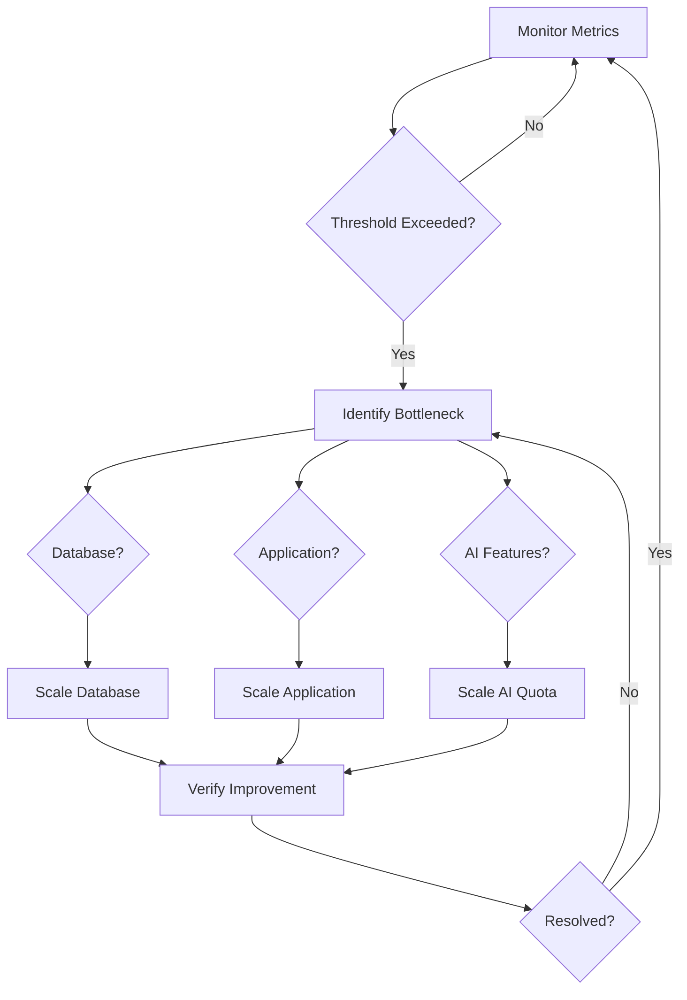

# Monitoring & Alerting

Procedures for monitoring, alerting, and incident response in production.

## Monitoring Areas

### Application Monitoring

| Metric | Tool | Threshold | Action |
|--------|------|-----------|--------|
| **Response time (p95)** | Vercel Analytics | > 2s | Investigate slow routes |
| **Response time (p99)** | Vercel Analytics | > 5s | Critical performance issue |
| **Error rate (5xx)** | Vercel Logs | > 1% | Immediate investigation |
| **Availability** | Uptime monitor | < 99.9% | Incident response |
| **Build failures** | Vercel dashboard | Any | Fix before next deploy |
| **Memory usage** | Vercel runtime | > 80% | Scale or optimize |

### Database Monitoring

| Metric | Tool | Threshold | Action |
|--------|------|-----------|--------|
| **Connection count** | Supabase dashboard | > 80% pool | Scale connection pool |
| **Query duration (p95)** | Supabase logs | > 1s | Optimize slow queries |
| **Database size** | Supabase dashboard | > 80% quota | Plan scaling |
| **Replication lag** | Supabase dashboard | > 5s | Investigate replication |
| **Failed connections** | Supabase logs | Any | Check credentials, pool |
| **Migration status** | Prisma migrate status | Out of sync | Run pending migrations |

### AI Feature Monitoring

| Metric | Tool | Threshold | Action |
|--------|------|-----------|--------|
| **AI response time** | Application logs | > 30s | Check API rate limits |
| **AI error rate** | Application logs | > 5% | Check API keys, quotas |
| **Token usage** | OpenAI dashboard | > 80% quota | Review usage patterns |
| **PHI stripping failures** | Audit logs | Any | Critical — investigate immediately |
| **AI output quality** | Manual review | Flagged outputs | Review prompt templates |

### Security Monitoring

| Metric | Tool | Threshold | Action |
|--------|------|-----------|--------|
| **Failed login attempts** | Audit logs | > 10/hour from single IP | Rate limit, investigate |
| **Unauthorized access attempts** | Audit logs | Any | Incident response |
| **PHI access patterns** | Audit logs | Unusual patterns | Compliance review |
| **File access anomalies** | Audit logs | Bulk downloads | Security investigation |
| **API rate limit hits** | Application logs | > 100/hour per user | Review rate limits |
| **SSL certificate expiry** | Uptime monitor | < 30 days | Renew certificate |

## Alert Rules

### Critical Alerts (Immediate Response)

| Alert | Trigger | Channel | Response Time |
|-------|---------|---------|---------------|
| **Service down** | Health check fails 3x | Phone + Email + Slack | 15 minutes |
| **Database unreachable** | Connection fails 3x | Phone + Email + Slack | 15 minutes |
| **PHI breach detected** | Unauthorized PHI access | Phone + Email + Slack | Immediate |
| **Data loss detected** | Unexpected data deletion | Phone + Email + Slack | Immediate |
| **Security incident** | Intrusion detected | Phone + Email + Slack | Immediate |

### Warning Alerts (Same-Day Response)

| Alert | Trigger | Channel | Response Time |
|-------|---------|---------|---------------|
| **High error rate** | 5xx errors > 1% | Email + Slack | 4 hours |
| **Slow response times** | p95 > 2s | Email + Slack | 4 hours |
| **Database nearing limits** | Storage > 80% | Email | 24 hours |
| **AI quota low** | < 20% remaining | Email | 24 hours |
| **Failed migrations** | Migration errors | Email | 4 hours |

### Info Alerts (Weekly Review)

| Alert | Trigger | Channel | Response Time |
|-------|---------|---------|---------------|
| **Usage spike** | 2x normal traffic | Email | Weekly review |
| **New error pattern** | Unique error > 10 occurrences | Email | Weekly review |
| **Performance degradation** | Gradual increase over 7 days | Email | Weekly review |

## Logging Strategy

### Log Levels

| Level | Usage | Example |
|-------|-------|---------|
| `ERROR` | System errors requiring attention | Database connection failed |
| `WARN` | Potential issues to monitor | Rate limit approaching |
| `INFO` | Important business events | Case created, opinion signed |
| `DEBUG` | Development troubleshooting | API request/response details |

### What to Log

**Always log:**

- Authentication events (login, logout, failed attempts)
- Case lifecycle events (created, routed, opinion signed, delivered)
- AI feature invocations (pre-screen, summary, synthesis)
- PHI stripping events (what was removed, not the content itself)
- File access events (upload, download, view)
- Admin actions (status overrides, dispute resolution)
- Errors and exceptions

**Never log:**

- Passwords or password hashes
- Full PHI (names, DOB, MRN)
- API keys or secrets
- Session tokens
- Credit card numbers
- Raw AI prompts with PHI

### Log Retention

| Log Type | Retention | Storage |
|----------|-----------|---------|
| Application logs | 30 days | Vercel / hosting platform |
| Audit logs | 7 years | Supabase (compliance) |
| Error logs | 90 days | Sentry / error tracking |
| Access logs | 1 year | CDN / hosting platform |

## Dashboards

### Recommended Monitoring Stack

| Tool | Purpose | Cost |
|------|---------|------|
| **Vercel Analytics** | Performance, Web Vitals | Included with Pro |
| **Supabase Dashboard** | Database metrics, storage | Included with plan |
| **Sentry** | Error tracking, performance | Free tier available |
| **OpenAI Dashboard** | AI usage, quotas | Pay per usage |
| **UptimeRobot** | Uptime monitoring | Free tier available |

### Key Dashboard Views

**Application Health Dashboard:**

- Response time trends (p50, p95, p99)
- Error rate by route
- Active sessions
- Build/deploy status

**Database Dashboard:**

- Query performance
- Connection pool usage
- Storage usage
- Migration status

**AI Feature Dashboard:**

- Request volume by feature
- Average response time
- Token usage and costs
- Error rates

**Security Dashboard:**

- Failed authentication attempts
- Unauthorized access attempts
- PHI access patterns
- Rate limit hits

## Incident Response

### Severity Levels

| Level | Description | Response Time | Example |
|-------|-------------|---------------|---------|
| **SEV1** | Service completely down or data breach | 15 minutes | Database unreachable, PHI exposed |
| **SEV2** | Major feature broken or data integrity issue | 1 hour | AI features failing, file upload broken |
| **SEV3** | Minor feature degraded or performance issue | 4 hours | Slow response times, non-critical errors |
| **SEV4** | Cosmetic issue or enhancement request | Next sprint | UI glitch, minor UX improvement |

### Incident Response Steps

1. **Detect** — Monitoring alert triggers or user reports issue
2. **Triage** — Assess severity and impact
3. **Respond** — Take immediate action to mitigate
4. **Resolve** — Fix the root cause
5. **Review** — Post-incident review and documentation

### SEV1 Response Checklist

- [ ] Acknowledge alert within 15 minutes
- [ ] Assess impact (users affected, data at risk)
- [ ] If data breach suspected, initiate breach protocol
- [ ] Communicate status to stakeholders
- [ ] Roll back recent deployment if caused by change
- [ ] Engage database provider support if infrastructure issue
- [ ] Document timeline and actions taken
- [ ] Conduct post-incident review within 48 hours

### Communication Templates

**Service Degradation:**

```
We're experiencing issues with [feature]. Our team is investigating.
Updates will be posted at [status page]. Estimated resolution: [time].
```

**Data Breach (Internal):**

```
CRITICAL: Potential data breach detected.
- Time detected: [timestamp]
- Affected systems: [systems]
- Data potentially exposed: [types]
- Immediate actions taken: [actions]
Next: Contact legal team, notify authorities within 72 hours.
```

## Compliance Monitoring

### HIPAA Monitoring

| Requirement | Monitoring Method | Frequency |
|-------------|------------------|-----------|
| Access controls working | Audit log review | Weekly |
| PHI encryption at rest | Supabase dashboard | Monthly |
| PHI encryption in transit | TLS certificate check | Daily |
| Minimum necessary access | Audit log analysis | Monthly |
| Breach notification readiness | Incident response test | Quarterly |

### GDPR Monitoring

| Requirement | Monitoring Method | Frequency |
|-------------|------------------|-----------|
| Consent records present | Database query | Monthly |
| Data deletion requests processed | Deletion request queue | Weekly |
| Data export requests fulfilled | Export request queue | Weekly |
| Data processing lawful basis | Consent audit | Quarterly |
| Privacy policy current | Document review | Annually |

## Scaling Considerations

### When to Scale

| Metric | Threshold | Action |
|--------|-----------|--------|
| **Database connections** | > 80% pool | Increase pool size or add replicas |
| **Response time (p95)** | > 2s sustained | Optimize queries, add caching |
| **Storage usage** | > 80% quota | Upgrade plan or archive old data |
| **AI request volume** | Approaching rate limits | Request quota increase |
| **Concurrent users** | > 1000 | Consider horizontal scaling |

### Scaling Strategy



### Database Scaling Options

1. **Connection pooling** — PgBouncer (already via Supabase)
2. **Read replicas** — For read-heavy workloads
3. **Vertical scaling** — More CPU/RAM on database server
4. **Query optimization** — Indexing, query rewriting
5. **Caching layer** — Redis for frequently accessed data

### Application Scaling Options

1. **Vercel auto-scaling** — Serverless functions scale automatically
2. **Edge functions** — Move static/simple logic to edge
3. **CDN** — Cache static assets globally
4. **Background jobs** — Move heavy processing to queues
